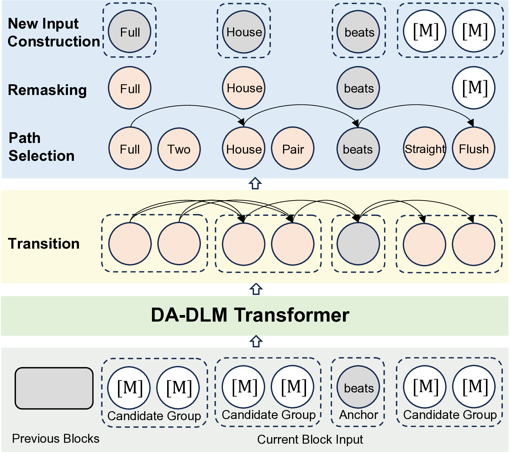

# [DA-DLM: Explicitly Modeling Token Dependencies in Diffusion Language Models](https://arxiv.org/abs/2609.15070) (EMNLP 2026 Main Conference)

By Pengyu Ji, Zichen Zhang, Xiang Hu, Kewei Tu



DA-DLM models dependencies between tokens through a directed acyclic graph during masked diffusion. The code supports language model pretraining and summarization, with AR, MDLM and BD3LM baselines sharing the same Transformer and training pipeline.

## Getting Started

Create the environment:

```bash
conda env create -f environment.yml
conda activate dadlm
```

The environment includes PyTorch and the CUDA tools. A compatible NVIDIA driver is required for GPU training, and the DAG kernels compile on first use.

Start from scratch. Prepare a local OpenWebText Dataset and GPT-2 tokenizer, then run the following commands from the repository root after replacing the two asset paths.

```bash
export CORPUS_PATH=/path/to/owt
export TOKENIZER_PATH=/path/to/gpt2
export OUTPUT_DIR="$PWD/outputs/dadlm_owt"
export REVISION=79d93d786212f7344586290adb811d4ae6a1762c

bash scripts/pretraining/prepare_owt.sh

EXPERIMENT=dadlm_owt GPUS_PER_NODE=8 \
  bash scripts/pretraining/pretrain_single_node.sh \
    startup.mode=fresh startup.path=null \
    data.revision="$REVISION" \
    runtime.local_batch_size=12 runtime.accumulate_grad_batches=2
```

This example uses eight GPUs on one node, BF16 training and a global batch of 192 sequences (`12 × 8 × 2`). Change the GPU count, local batch and accumulation to fit your hardware. Training writes checkpoints under  `outputs/dadlm_owt/checkpoints/` and saves the tokenizer beside them.

Training recipes live in `configs/experiment/`. Once you have trained a model, use the scripts in `scripts/summary/` for summary fine-tuning and evaluation, or `scripts/text/` for open-text generation and scoring.

## Code Organization

| Path | Contents |
| --- | --- |
| `main.py` | Entry point for data preparation, training and evaluation |
| `configs/` | Model, data, generation and experiment settings |
| `data/` | Tokenizers, preprocessing, packing and data loaders |
| `models/` | Shared Transformer and AR, MDLM, BD3LM and DADLM models |
| `objectives/` | Training losses and target-to-node assignments |
| `graph/` | DAG operations and their PyTorch/CUDA implementations |
| `training/` | Training loop, EMA, checkpoint initialization and resume |
| `generation/` | Decoders, reveal strategies and sampling |
| `kv_cache/` | KV cache storage and generation sessions |
| `evaluation/` | Text generation metrics and summary ROUGE |
| `weight_adapters/` | Weight import and transfer between model families |
| `scripts/` | Training and evaluation launchers, parameter sweeps and local examples |

## Citation

```bibtex
@misc{ji2026dadlmexplicitlymodelingtoken,
      title={DA-DLM: Explicitly Modeling Token Dependencies in Diffusion Language Models},
      author={Pengyu Ji and Zichen Zhang and Xiang Hu and Kewei Tu},
      year={2026},
      eprint={2609.15070},
      archivePrefix={arXiv},
      primaryClass={cs.CL},
      url={https://arxiv.org/abs/2609.15070},
}
```
